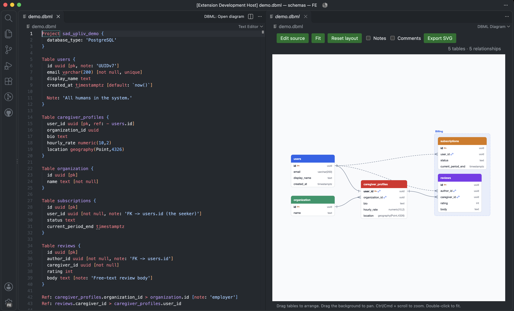
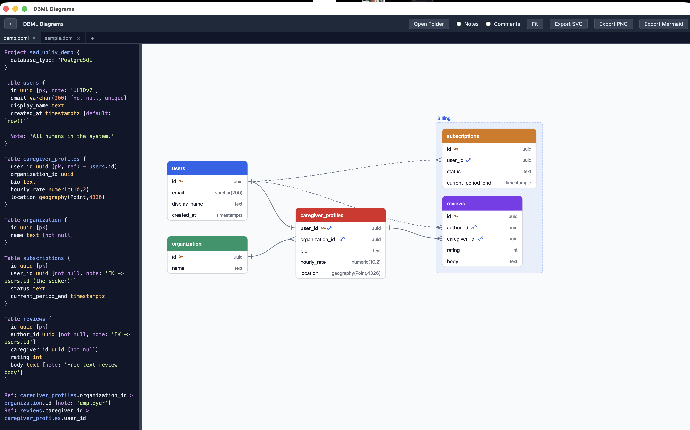

# DBML Diagrams

View DBML as interactive database diagrams.

It comes with:

- VS Code extension
- Offline app
- CLI
- agent skill

VS Code extension:

- generate table diagrams
- DBML syntax highlighting in VS Code

Offline app

- generate/preview table diagrams
- open a folder with multiple diagrams
- edit DBML

CLI

- convert DBML to a Mermaid diagram
- convert DBML to JSON


## VS Code extension

https://marketplace.visualstudio.com/items?itemName=Abidghods.dbml-diagrams



## App



### How to install

From the [repo](https://github.com/abetss/offline-er-diagram) root on macOS, with Node.js 22.12+, Rust, and Xcode Command Line Tools installed:

```sh
npm ci
npm ci --prefix frontend
./bin/dbml build
cp -R "src-tauri/target/release/bundle/macos/DBML Diagrams.app" /Applications/
```

Open **DBML Diagrams** from Applications. Edit syntax-highlighted DBML, open a file, or choose **Open Folder** to open every DBML file, including subfolders. Export SVG, PNG, or Mermaid.

### How to update

Quit the app, then run from the repo root:

```sh
git pull
npm ci
npm ci --prefix frontend
./bin/dbml build
ditto "src-tauri/target/release/bundle/macos/DBML Diagrams.app" "/Applications/DBML Diagrams.app"
```

Reopen **DBML Diagrams** from Applications. Your saved tabs are preserved.

## CLI and agent skill

### How to install

Rust is required. Add this repo's `bin` directory to `PATH`. In Bash, Zsh, or another POSIX shell, run from the repo root:

```sh
export PATH="$PWD/bin:$PATH"
dbml help
```

You can now run `dbml` from any directory in this terminal. For permanent setup, add the repo's absolute `bin` path to `PATH` in your shell's startup configuration or system environment settings, then open a new terminal. The parser builds automatically on first use.

### How to use

From the [repo](https://github.com/abetss/offline-er-diagram) root:

```sh
dbml open fixtures/todo.dbml
dbml mermaid fixtures/todo.dbml > schema.mmd
dbml json fixtures/todo.dbml
dbml help
```

`open` requires the app built above. `mermaid` also accepts DBML on stdin.

### How to update

Run `git pull` from the repo root. The CLI uses the updated scripts immediately and rebuilds the parser when its source changes. For `dbml open`, follow the app update steps above.

## Agent Skill

1. Copy the skill from skills/dbml-db-schema.
2. Set `DBML=` in the copied `SKILL.md` to this [repo](https://github.com/abetss/offline-er-diagram)'s absolute `bin/dbml` path, then restart your agent.

Example prompts:

- Use dbml-db-schema to open schema.dbml and generate a Mermaid diagram for my docs.
- Create a DBML diagram from this schema.
