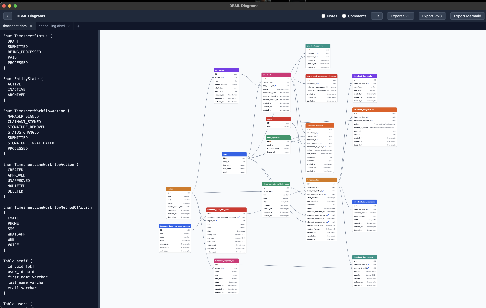

# DBML Diagrams

A local, offline **dbdiagram.io-style** ER-diagram tool for macOS. Paste [DBML](https://dbml.dbdiagram.io/docs/)
on the left, get a live relationship diagram on the right — colored table cards, PK/FK icons,
crow's-foot relationship splines, a Notes toggle, pan/zoom, and drag-to-arrange. Export to
**SVG / PNG / Mermaid**. Runs as a native `.app` (Tauri v2, Rust backend + web frontend); the DBML
parser is pure Rust and also usable headless from the CLI.

> This is a personal tool, **not a git repo**. It is unsigned (no Apple Developer ID) — see
> [Gotchas](#gotchas).



## VS Code extension

Install [dbml-diagrams-0.1.0.vsix](dbml-diagrams-0.1.0.vsix) via **Extensions → … → Install from VSIX…**, or run from this folder:

```sh
code --install-extension dbml-diagrams-0.1.0.vsix
```

Click a `.dbml` file to view its diagram.

---

## TL;DR — the commands you'll actually use

```sh
# 0. Rust lives in a keg-only rustup — export this in EVERY shell that runs cargo/tauri:
export PATH="/opt/homebrew/opt/rustup/bin:$HOME/.cargo/bin:$PATH"

# 1. Live dev app (native window, hot-reload frontend, REAL Rust parser):
npx tauri dev                       # run from the repo root

# 2. Build the production .app:
npx tauri build --bundles app       # -> src-tauri/target/release/bundle/macos/DBML Diagrams.app

# 3. Run the built app on a schema file:
./bin/dbml open fixtures/care_marketplace.dbml

# 4. Headless DBML -> Mermaid (no GUI; also reads stdin):
./bin/dbml mermaid fixtures/demo.dbml

# See every command:
./bin/dbml help

# 5. Tests:
cargo test --manifest-path parser-rs/Cargo.toml    # parser (needs the PATH above)
cargo test --manifest-path src-tauri/Cargo.toml    # tauri shell
cd frontend && npm run test                         # renderer/layout (vitest)
```

---

## Prerequisites

| Tool | Version used | Notes |
|---|---|---|
| macOS | — | Apple Silicon (`/opt/homebrew`) |
| Rust (via rustup) | cargo/rustc **1.97.1** | Installed **keg-only** via Homebrew. `cargo` is at `/opt/homebrew/opt/rustup/bin/cargo`. **Not on PATH by default.** |
| Node | **v24** | |
| npm | **11** | |

**The one thing that trips you up:** `cargo` is not on your PATH. Before any `cargo` or `npx tauri`
command, run:

```sh
export PATH="/opt/homebrew/opt/rustup/bin:$HOME/.cargo/bin:$PATH"
```

Node deps are already installed (`node_modules/` at root and in `frontend/`). If you ever need to
reinstall: `npm install` at the repo root **and** `npm install` in `frontend/`.

---

## Repository layout

```
db-diagrams/
├── package.json            # root: provides the `tauri` CLI (@tauri-apps/cli) → `npx tauri …`
├── bin/
│   ├── dbml-diagrams       # sh wrapper: open the .app on a .dbml file
│   └── dbml2mermaid        # sh wrapper: headless DBML → Mermaid (file or stdin)
├── parser-rs/              # Rust crate: the DBML parser (the heart of the tool)
│   ├── src/
│   │   ├── model.rs        # the Schema data contract (Rust side)
│   │   ├── tokenizer.rs    # DBML lexer
│   │   ├── parser.rs       # DBML → Schema
│   │   ├── mermaid.rs      # Schema → Mermaid erDiagram (single source of truth)
│   │   ├── lib.rs          # parse_dbml() + to_mermaid() exports
│   │   └── bin/
│   │       ├── parse.rs    # `parse <file>` → canonical JSON on stdout
│   │       └── mermaid.rs  # `mermaid <file|stdin>` → Mermaid on stdout
│   └── tests/              # golden.rs, negative.rs, unit.rs
├── src-tauri/              # Tauri v2 desktop shell (Rust)
│   ├── src/lib.rs          # #[tauri::command]s: parse_dbml, cli_schema, save_export, to_mermaid
│   ├── tauri.conf.json     # window, bundle targets, before-dev/build commands
│   ├── icons/              # app icon set
│   └── target/…            # build output (the .app lands here)
├── frontend/               # Vite + vanilla TypeScript + SVG (no framework)
│   ├── index.html
│   └── src/
│       ├── app.ts          # app shell: toolbar, editor, collapse/resize, export handlers
│       ├── app.css
│       ├── contract.ts     # the Schema data contract (TS side — MUST match model.rs)
│       ├── parse-adapter.ts# picks the fixture vs tauri parser adapter (see below)
│       ├── adapters/       # fixture.ts (browser, canned) + tauri.ts (invoke real parser)
│       ├── render.ts       # pure render(container, schema, opts) → SVG
│       ├── theme.ts        # colors / card styling
│       ├── layout.ts       # deterministic auto-layout (layered on the FK graph)
│       ├── interaction.ts  # pan / zoom / drag / fit
│       └── *.test.ts       # vitest suites
├── fixtures/               # sample/demo/care_marketplace .dbml + *.expected.json goldens
├── skills/                 # agent skill for the `dbml` CLI — copy into your skills folder
├── docs/                   # design docs (read these before changing the contract!)
│   ├── data-contract.md    # ← the Schema JSON seam; the most important doc
│   ├── dbml-grammar.md     # what DBML we support / reject
│   ├── design.md
│   └── layout-and-render.md
└── dist/                   # a built .dmg (may be stale — see Packaging)
```

---

## How it works (architecture)

The whole app is built around **one JSON contract** — the `Schema` object — that sits between the
Rust parser and the TypeScript renderer. The renderer never sees DBML text; it only consumes `Schema`.

```
 DBML text (editor)
      │  invoke('parse_dbml', { text })
      ▼
 parser_rs::parse_dbml()  ──►  ParseResult { ok, schema: Schema, error }   (Rust)
      │                                    │ (canonical JSON over Tauri IPC)
      ▼                                    ▼
 error bar (on !ok)                  render(container, schema, opts)  ──►  SVG   (TS, pure)
                                           │
                                     interaction: pan / zoom / drag / fit
```

- **The contract is defined twice and must stay in sync:** `parser-rs/src/model.rs` (Rust) and
  `frontend/src/contract.ts` (TS). If you change the shape, change **both** and update the
  `fixtures/*.expected.json` goldens. `docs/data-contract.md` is the authoritative spec (key order,
  null rules, `isFk` derivation, from-note FK extraction, dedup).
- **Mermaid** has a single generator: `parser_rs::to_mermaid(&Schema)`. The app's *Export Mermaid*
  button calls the `to_mermaid` Tauri command (parse + generate); the `bin/dbml2mermaid` CLI calls
  the same function. One source of truth → GUI and CLI never diverge.
- **CLI file loading:** the app reads the first non-flag argv as a file path and exposes it via the
  `cli_schema` command; `app.ts` seeds the editor from it on startup.
- **Export:** `save_export(name, kind, data)` writes to `~/Downloads`. `kind` = `svg` / `mmd` /
  `mermaid` → UTF-8; `png` → base64-decoded.

### The parser adapter (important when developing the UI)

`frontend/src/parse-adapter.ts` selects the parser at build time via the `VITE_ADAPTER` env var:

| How you run it | `VITE_ADAPTER` | Adapter | Parses your DBML? |
|---|---|---|---|
| `npx tauri dev` / packaged `.app` | `tauri` | calls real Rust `parse_dbml` | **Yes** |
| `cd frontend && npm run dev` | *(unset)* | **fixture** (canned schema) | **No** — ignores editor text |

So plain `npm run dev` is only useful for iterating on **render/layout/interaction/CSS** against a
fixed schema. Anything that needs real parsing or Mermaid export (which is Rust-only) requires
`npx tauri dev` or the built app.

---

## Development

### Live app with hot reload (recommended)

```sh
export PATH="/opt/homebrew/opt/rustup/bin:$HOME/.cargo/bin:$PATH"
npx tauri dev            # from repo root
```

This runs the config's `beforeDevCommand` (`npm --prefix frontend run dev:tauri`, i.e. Vite on
`http://localhost:5173` with `VITE_ADAPTER=tauri`), then opens the native window pointed at it.
Editing `frontend/src/**` hot-reloads instantly. Editing **Rust** (`parser-rs` or `src-tauri`)
triggers a recompile + relaunch.

### Frontend-only in a browser (UI/CSS iteration, fixture data)

```sh
cd frontend && npm run dev     # http://localhost:5173  (fixture adapter — see table above)
```

### Type-check / build / test the frontend

```sh
cd frontend
npm run typecheck     # tsc --noEmit
npm run build         # tsc && vite build   → frontend/dist
npm run test          # vitest run
```

---

## Building the app

```sh
export PATH="/opt/homebrew/opt/rustup/bin:$HOME/.cargo/bin:$PATH"
npx tauri build --bundles app
# → "src-tauri/target/release/bundle/macos/DBML Diagrams.app"
```

`--bundles app` builds just the `.app`. **Do not** rely on a plain `npx tauri build` for
distribution: it also runs the `dmg` bundle target, whose `bundle_dmg.sh` needs Finder/AppleScript
automation and **fails in a headless/agent shell** (the `.app` is still produced fine).

`npx tauri build` runs `beforeBuildCommand` (`npm --prefix frontend run build:tauri`) automatically,
so the frontend is rebuilt and embedded into the binary — you don't build the frontend separately.

### Packaging a DMG (optional, manual)

Tauri's styled DMG step is unreliable headless, so build a plain drag-to-Applications DMG with
`hdiutil`:

```sh
APP="src-tauri/target/release/bundle/macos/DBML Diagrams.app"
STAGE="$(mktemp -d)/DBML Diagrams"
mkdir -p "$STAGE" && cp -R "$APP" "$STAGE/" && ln -s /Applications "$STAGE/Applications"
hdiutil create -volname "DBML Diagrams" -srcfolder "$STAGE" -ov -format UDZO \
  dist/DBML-Diagrams-0.1.0.dmg
```

> `dist/DBML-Diagrams-0.1.0.dmg` in the repo may be **stale** (pre-Mermaid/collapse). Rebuild it with
> the above only when you actually need to hand the app to someone; day-to-day you run the `.app`
> directly.

---

## The CLI — `bin/dbml`

One self-describing entry point. It **self-locates** (resolves the repo from its own path, so it works
from any directory and doesn't hard-code an absolute path) and sets the rustup PATH itself. Run
`./bin/dbml help` to see the whole interface:

```
dbml — local DBML ER-diagram tool CLI

USAGE:
  dbml <command> [file.dbml]

COMMANDS:
  open <file>      Open the desktop app, seeded with the given DBML schema
                   (if the app is already running, opens the file in a new tab)
  mermaid [file]   Print a Mermaid erDiagram for the schema (file or stdin)
  json [file]      Print the parsed schema as canonical JSON (file or stdin)
  build            Build the parser CLIs and the desktop .app
  help             Show this help

  mermaid/json accept a DBML file arg, or read DBML on stdin when given none.
```

```sh
./bin/dbml open    fixtures/care_marketplace.dbml   # launch the app on a schema
./bin/dbml mermaid fixtures/demo.dbml               # DBML → Mermaid (stdout)
cat schema.dbml | ./bin/dbml mermaid                # …or from stdin
./bin/dbml json    fixtures/demo.dbml               # DBML → canonical Schema JSON
./bin/dbml build                                    # build parser bins + the .app
```

Details:
- **`open`** execs the app binary directly (**not** macOS `open --args`, which strips argv) so the
  file path reaches the process. Needs the app built (`./bin/dbml build`, or `npx tauri build
  --bundles app`); otherwise it prints `App not built. Run: dbml build`. The app is single-instance:
  opening a second file while it's running forwards the path to the existing window, which opens it
  as a new tab (named after the file) rather than launching a second window. You can also add tabs
  in-app with the **+** button, or **Open** a file into a new tab.
- **Open Folder** in the toolbar or **File → Open Folder...** (`Cmd+Shift+O`) opens every `.dbml`
  file in the selected folder and its subfolders, one tab per file. Other file types are ignored;
  `.DBML` also works. Tabs use relative paths so identically named files in different subfolders
  are distinguishable. Existing tabs stay open, and unreadable files are reported while the rest open.
- **`mermaid` / `json`** auto-build the (fast) parser bins on first use if missing — build output goes
  to stderr so it never pollutes captured stdout. `mermaid` exits 0 on success; on a parse error it
  prints `error (line L:C): message` to stderr and exits 1; unreadable file exits 2.
- Unknown command → usage on stderr, exit 2.

**Tip:** put `bin/` on your PATH to call it from anywhere:
```sh
export PATH="/Users/abtinghods/Ork/tools/db-diagrams/bin:$PATH"
dbml mermaid schema.dbml
```

The old commands still exist as thin aliases: `bin/dbml-diagrams` → `dbml open`,
`bin/dbml2mermaid` → `dbml mermaid`.

### AI-agent workflow

The `.dbml` file **is** the integration surface — an LLM edits DBML text (LLMs are great at that),
then drives the tool through `dbml`:
- `dbml open schema.dbml` — view it in the app.
- `dbml mermaid schema.dbml` — get a Mermaid diagram (stdout; pipe-friendly).
- `dbml json schema.dbml` — read the structured schema back (`{"ok":true,"schema":…}`) to verify what
  it built, or catch a parse error (`{"ok":false,"error":{line,column,message}}`).

No live-app API or IPC needed — it's a plain file round-trip an agent can script.

### Agent skill

`skills/dbml-db-schema/SKILL.md` tells an agent when and how to use this CLI (open a schema in the
app vs. emit Mermaid for docs). Copy it into your agent's skills folder so agents make the best use of
`dbml`:

```sh
cp -R skills/dbml-db-schema ~/.claude/skills/
```

If the repo lives somewhere other than `~/Ork/tools/db-diagrams`, update the `DBML=` path in the
copied `SKILL.md` to point at this repo's `bin/dbml`.

---

## Tests

```sh
export PATH="/opt/homebrew/opt/rustup/bin:$HOME/.cargo/bin:$PATH"
cargo test --manifest-path parser-rs/Cargo.toml     # ~23 tests: golden, negative, unit, mermaid
cargo test --manifest-path src-tauri/Cargo.toml     # ~3 tests: commands + save_export
cd frontend && npm run test                          # ~19 tests: contract, layout, render (vitest)
```

Golden tests parse `fixtures/*.dbml` and compare against `fixtures/*.expected.json`. When you change
parser behavior, regenerate/adjust the expected JSON and keep Rust `model.rs` ⇄ TS `contract.ts` in
sync.

---

## Where to change things

| I want to… | Edit |
|---|---|
| Support new DBML syntax | `parser-rs/src/tokenizer.rs`, `parser.rs`; add a golden fixture; update `docs/dbml-grammar.md` |
| Change the `Schema` shape | `parser-rs/src/model.rs` **and** `frontend/src/contract.ts` **and** the fixtures + `docs/data-contract.md` |
| Change table colors / card look | `frontend/src/theme.ts`, `render.ts` |
| Change auto-layout | `frontend/src/layout.ts` |
| Change pan/zoom/drag | `frontend/src/interaction.ts` |
| Change the Mermaid output | `parser-rs/src/mermaid.rs` (+ its `#[cfg(test)]` tests) |
| Add a toolbar button / wire a feature | `frontend/index.html`, `frontend/src/app.ts`, `app.css` |
| Add a backend command | add `#[tauri::command]` in `src-tauri/src/lib.rs`, register it in `generate_handler![…]`, call it from `app.ts` via the `tauriInvoke` helper |

---

## Gotchas

- **`cargo: command not found` / build can't find Rust** → you forgot
  `export PATH="/opt/homebrew/opt/rustup/bin:$HOME/.cargo/bin:$PATH"`.
- **`npx tauri build` fails at the DMG step** → expected headless; use `npx tauri build --bundles app`.
  The `.app` is built regardless.
- **Plain `npm run dev` "ignores my DBML"** → that's the **fixture** adapter. Use `npx tauri dev`.
- **Unsigned app / Gatekeeper** ("can't be opened because Apple cannot check it") → there is no Apple
  Developer ID for this app (intentionally). Clear quarantine once:
  `xattr -dr com.apple.quarantine "src-tauri/target/release/bundle/macos/DBML Diagrams.app"`.
- **Table drag positions reset on app restart.** Editor **width** and **collapsed** state persist
  (localStorage: `dbml.editorWidth`, `dbml.editorCollapsed`); table positions are in-session only.
- **Known parser limits:** `indexes { }` and `Enum`/`Project`/sticky-`Note` blocks are parsed but not
  rendered; composite/multi-column FKs and `schema.table`-qualified names are not supported. See
  `docs/data-contract.md` §5 and `docs/dbml-grammar.md`.
- **`bin/` scripts self-locate** (they resolve the repo from their own path), so you can move the repo
  freely — but the built `.app` and parser bins live under the repo, so after a move run `dbml build`
  (or `npx tauri build --bundles app`) to regenerate them.
